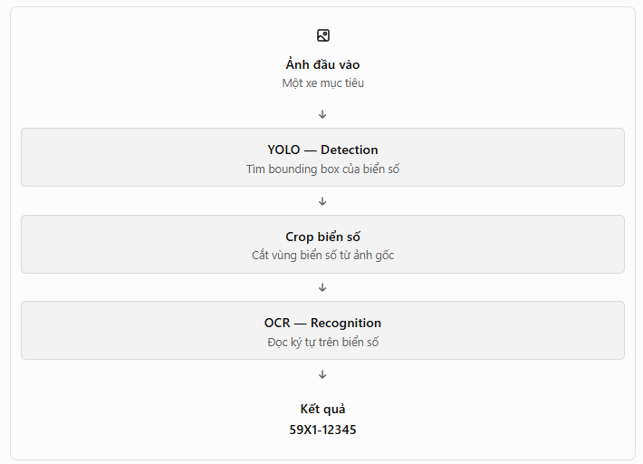

# CS406 – Nhận diện biển số xe máy Việt Nam (VNLP)

Đồ án môn CS406 – Xử lý ảnh và ứng dụng.
Pipeline: **YOLO phát hiện biển → crop → tiền xử lý → OCR (CRNN / PARSeq) → hậu xử lý theo luật biển VN**.



## Cấu trúc thư mục

```
CS406_VNLP_2027/
├── config.yaml              ← MỌI cấu hình: đường dẫn, siêu tham số, bật/tắt phần notebook
├── requirements.txt         ← cài local
├── requirements-kaggle.txt  ← gói thêm trên Kaggle
│
├── vnlp/                    ← toàn bộ code Python
│   ├── config.py               đọc config.yaml, tính sẵn đường dẫn
│   ├── pipeline.py             ảnh gốc -> YOLO -> OCR -> biển số; đánh giá end-to-end
│   ├── data/                   chuẩn bị dữ liệu (xem "Quy trình dữ liệu")
│   ├── detection/              train.py, evaluate.py, plot_training.py (YOLO)
│   ├── recognition/            preprocess.py, postprocess.py, crnn.py, parseq.py
│   └── utils/                  io.py, metrics.py, plotting.py
│
├── apps/
│   ├── demo/                   web demo Flask (ảnh/video)
│   └── ocr_viewer.py           web xem nhanh ảnh + nhãn của một split OCR
├── notebooks/main.ipynb     ← notebook chính: data -> train -> eval -> pipeline
├── docs/                    ← yêu cầu đồ án, hướng dẫn trình bày, sơ đồ
├── dataset/                 ← splits/ (không lên git) + 2 manifest CSV
└── outputs/                 ← weights, history, biểu đồ (không lên git)
```

## Cài đặt (local)

```bash
python -m venv .venv
.venv\Scripts\activate                     # Linux/macOS: source .venv/bin/activate
pip install torch torchvision --index-url https://download.pytorch.org/whl/cpu   # máy có GPU: xem pytorch.org
pip install -r requirements.txt
pip install --no-deps "strhub @ git+https://github.com/baudm/parseq.git@1902db043c029a7e03a3818c616c06600af574be"
```

## Dữ liệu

Data gốc trên Google Drive: <https://drive.google.com/drive/folders/1AAwdv0Kv0_UM4muJe-nmlt7rWpdf4prR?usp=sharing>
Giải nén cạnh repo thành `../dataset_CS406/` (đường dẫn chỉnh trong `config.yaml -> paths`).

| View | Nguồn |
|---|---|
| view1 | Camera lối ra UIT (đã cắt tập trung vào xe đang ra cổng) |
| view2 | Camera lối vào UIT |
| view3 | Ảnh tĩnh xe đậu trong bãi |
| view4 | Dataset ngoài, xe qua cổng |
| view5 | Khung hình rộng 1920×1080 của chính các frame view1 (chỉ dùng cho detection) |

### Quy trình dữ liệu

Chạy từ gốc repo, mọi tham số lấy từ `config.yaml`:

| Bước | Lệnh | Vào → Ra |
|---|---|---|
| 1. Crop biển số | `python -m vnlp.data.crop_plates` | `raw_dir` → `crops_dir` (label.txt rỗng) |
| 2. Gợi ý nhãn | `python -m vnlp.data.label_plates` | PARSeq đọc thử, ghi vào label.txt |
| 3. Review tay | (công cụ review riêng) | `crops_dir` → `processed_dir` |
| 4. Chia OCR | `python -m vnlp.data.split_recognition` | → `dataset/splits/recognition`, `dataset/recognition_split.csv` |
| 5. Chia detection | `python -m vnlp.data.split_detection` | → `dataset/splits/detection`, `dataset/detection_split.csv` |

Cách chia:
* **OCR**: chia theo **biển số** (một biển chỉ nằm ở 1 split → test luôn là biển chưa thấy), phân tầng theo view, 70/15/15.
* **Detection**: mỗi ảnh vào **cùng split với biển số của nó bên OCR**; view5 theo view1.
  → tập test detection và OCR khớp nhau, đánh giá end-to-end không rò rỉ.

## Train & đánh giá

**Notebook (khuyên dùng)**: mở `notebooks/main.ipynb` → Run All.
`notebook.quick_test: true` trong `config.yaml` để chạy thử vài ảnh trên máy không có GPU.

**Terminal**:

```bash
python -m vnlp.recognition.crnn train      # / eval
python -m vnlp.recognition.parseq train    # / eval
python -m vnlp.detection.train
python -m vnlp.detection.evaluate
python -m vnlp.detection.plot_training
```

Kết quả: `outputs/` (CRNN/PARSeq: `outputs/recognition/<model>/`, YOLO: `outputs/detection/`).

## Chạy trên Kaggle

1. Nén thư mục `dataset/` (gồm `splits/` + 2 file CSV) → tạo Kaggle Dataset (private).
2. Tạo notebook mới → *Import* `notebooks/main.ipynb` → *Add Input* dataset vừa tạo.
3. Settings: bật **Internet** + **GPU**.
4. Ở cell đầu: `OVERRIDES = {"notebook.quick_test": False}` → *Save Version* (Run All).
   Notebook tự clone repo, cài thư viện, tìm data trong `/kaggle/input`.

## Demo

```bash
python apps/demo/app.py        # cần weights YOLO + CRNN + PARSeq trong outputs/
python apps/ocr_viewer.py      # http://127.0.0.1:5050
```
